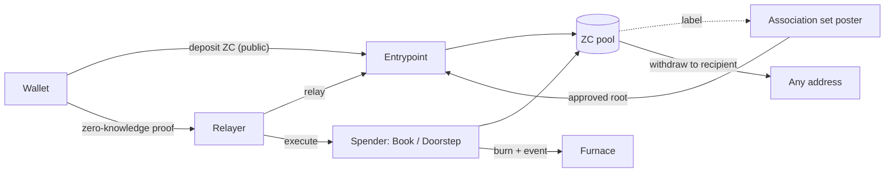

# Zipcoin

[](https://github.com/zcprivacy/zipcoin/actions/workflows/ci.yml)
[](LICENSE)

A shielded pool for ZC on Ethereum mainnet, with spender contracts that turn a private withdrawal
into an action: a withdrawal to any address, a burn-to-post entry on the Book, or a line left at an
address through the Doorstep.

Live at [zipcoin.zip](https://zipcoin.zip).

Zipcoin deploys the audited, Apache-2.0 [Privacy Pools v1](https://github.com/0xbow-io/privacy-pools-core)
core without modification and adds its own spender contracts, node and wallet. It is an independent
project, not affiliated with 0xbow, the Ethereum Foundation or Vitalik Buterin, whose novel
*Snowmoon* it takes as a design reference.

## Mainnet

| Contract | Address |
|---|---|
| Entrypoint (proxy) | [`0x7959a703F49B2d0baa29978c2A126076a0150190`](https://etherscan.io/address/0x7959a703F49B2d0baa29978c2A126076a0150190#code) |
| ZC pool | [`0x316E560405D221a01107392A7C1650916dd38F39`](https://etherscan.io/address/0x316E560405D221a01107392A7C1650916dd38F39#code) |
| The Book | [`0xfFa010d4106f20e58058909b612f75668Ae3764e`](https://etherscan.io/address/0xfFa010d4106f20e58058909b612f75668Ae3764e#code) |
| The Doorstep | [`0x8b72E65392ac44E30E50f7799EC8fe0585F3fD72`](https://etherscan.io/address/0x8b72E65392ac44E30E50f7799EC8fe0585F3fD72#code) |
| Timelock (owner, 48 h) | [`0x9CcE4FAcB48332846d075e0B793D06975Cb71e97`](https://etherscan.io/address/0x9CcE4FAcB48332846d075e0B793D06975Cb71e97#code) |
| ZC token | [`0xA2f6441c4839A7fD4eF8536b971ceD04c48A1CEA`](https://etherscan.io/token/0xA2f6441c4839A7fD4eF8536b971ceD04c48A1CEA) |

Deployed at block 26 251 103. Verifiers, implementation, constructor parameters, roles and how to
check the bytecode against this repository are in [docs/deployments.md](docs/deployments.md).

## How it works



1. **Deposit.** A wallet deposits ZC through the Entrypoint. The deposit is public. It creates a
   note: a commitment to the amount and a secret that only the wallet's zip key can derive.
2. **Approval.** The association set poster applies a published policy to each deposit and posts the
   root of the approved set on chain.
3. **Proof.** To spend, the browser proves that it owns a note in the pool whose label is in the
   approved set, without revealing which. The proof is bound to the exact recipient, amount, fee
   and payload.
4. **Relay.** A relayer submits the proof and pays the gas, so the user's wallet never signs a
   withdrawal. The relayer can only collect the fee the user fixed before proving.
5. **Spend.** The pool pays a recipient, or a spender acts on the payload: the Book burns the amount
   and records the text; the Doorstep does the same at one address.

The specification is in [docs/spec.md](docs/spec.md). What every key can and cannot do is in
[docs/trust-model.md](docs/trust-model.md). The approval policy is in
[docs/asp-policy-v1.md](docs/asp-policy-v1.md).

## Run your own

Nothing in this repository depends on infrastructure operated by the Zipcoin team. A clone can
index the same mainnet contracts, relay withdrawals for a fee, serve the wallet, or deploy a new
instance of the protocol for another token.

```
git clone --recurse-submodules https://github.com/zcprivacy/zipcoin.git
```

| Goal | Where to start |
|---|---|
| Run a node: indexer and API | `services/node`, `ROLES=indexer,api` |
| Run a relayer and earn the relay fee | `services/node`, `ROLES=indexer,api,relayer` |
| Serve the wallet against your node | `app`, with `/api/*` proxied to your node |
| Deploy the protocol for another token | `protocol/script/Deploy.s.sol` |

Step by step in [docs/run-your-own.md](docs/run-your-own.md).

## Verify

Every contract is verified on Etherscan and matched on Sourcify. The tag
[`mainnet-2026-10-23`](https://github.com/zcprivacy/zipcoin/releases/tag/mainnet-2026-10-23)
marks the source the deployment was built from; `forge build` at that tag reproduces the bytecode.
Role assignments and timelock delay can be checked with two calls, listed in
[docs/deployments.md](docs/deployments.md).

## Trust model, in short

- No key can move funds inside the pool. A note moves only on a proof made by its owner.
- Ragequit returns a note to the wallet that deposited it, with no approval from anyone.
- The spender contracts hold no funds between transactions and have no owner.
- The only administrative role is held by a timelock with a 48-hour delay, so every change is
  visible two days before it can execute.
- The relayer key pays gas and receives fees. The poster key publishes approved sets. Neither can
  touch a note.

## Repository

| Directory | Contents |
|---|---|
| `protocol/` | Foundry package: spender contracts, deployment script, tests, deployment record |
| `services/node/` | One Node.js service with four roles: indexer, API, association-set poster, relayer |
| `app/` | The website and wallet: zip key derivation, note recovery, in-browser proving, the Book and the Doorstep |
| `docs/` | Specification, trust model, approval policy, deployment record, self-hosting guide, roadmap |

## Status

The pool, the Book and the Doorstep are live on mainnet. Progress is reported against the phases in
[docs/roadmap.md](docs/roadmap.md) and on the site. Phases have completion criteria, not dates.

## Licence

Apache-2.0. Third-party components and their licences are listed in [NOTICE](NOTICE). Security
reports: see [SECURITY.md](SECURITY.md).
